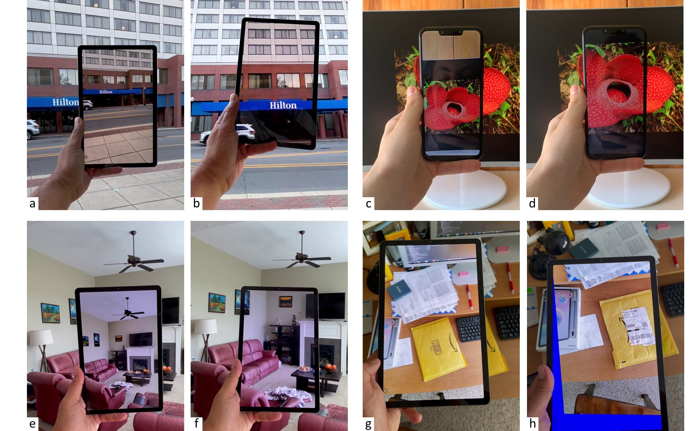

<div align="center">

# Improved Directional Guidance with Transparent AR Displays

[**Felix Strobel**](https://github.com/felixstrobel)<sup>1</sup> · [**Voicu Popescu**](https://www.cs.purdue.edu/people/faculty/popescu.html)<sup>2</sup>

<sup>1</sup>Karlsruhe Institute of Technology &nbsp;&nbsp; <sup>2</sup>Purdue University

**Accepted to GRAPP 2023** (VISIGRAPP, Lisbon)</br> 🏆&nbsp;**Best Paper Award Honorable Mention**

[](https://felixstrobel.github.io/transparent-ar-displays/)
[](static/paper.pdf)
[](https://doi.org/10.5220/0011613200003417)
[](https://felixstrobel.github.io/transparent-ar/#video)

<figure>
  
  <figcaption>Conventional (left of each pair) and our transparent (right) AR display</figcaption>
</figure>
 
</div>

---

## TL;DR

Handheld AR shows the world from the phone's camera, not from your eyes, so annotations on the screen don't line up with the real world. We make a phone or tablet look like a pane of glass using **only the back-facing camera**, with **no head tracking and no depth sensing**. In a user study (N = 17), our method reduced annotation localization error by **61%** compared to a conventional AR display.

## Abstract

In a popular form of augmented reality (AR), the scene is captured with the back-facing camera of a handheld phone or tablet, and annotations are overlaid onto the live video stream. However, the annotations are not integrated into the user's field of view, and the user is left with the challenging task of translating the annotations from the display to the real world. This challenge can be alleviated by modifying the video frame to approximate what the user would see in the absence of the display, making the display seem transparent. This paper demonstrates a robust transparent display implementation using only the back-facing camera of a tablet, which was tested extensively over a variety of complex real world scenes. A user study shows that the transparent AR display lets users locate annotations in the real world significantly more accurately than when using a conventional AR display.

## Citation

If you find this work useful, please cite:

```bibtex
@inproceedings{strobel2023transparent,
  author       = {Strobel, Felix P. and Popescu, Voicu},
  title        = {Improved Directional Guidance with Transparent AR Displays},
  booktitle    = {Proceedings of the 18th International Joint Conference on Computer Vision,
                  Imaging and Computer Graphics Theory and Applications
                  (VISIGRAPP 2023) - Volume 1: GRAPP},
  pages        = {27--38},
  year         = {2023},
  publisher    = {SciTePress},
  organization = {INSTICC},
  doi          = {10.5220/0011613200003417},
  isbn         = {978-989-758-634-7}
}
```
